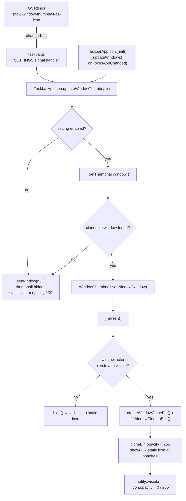
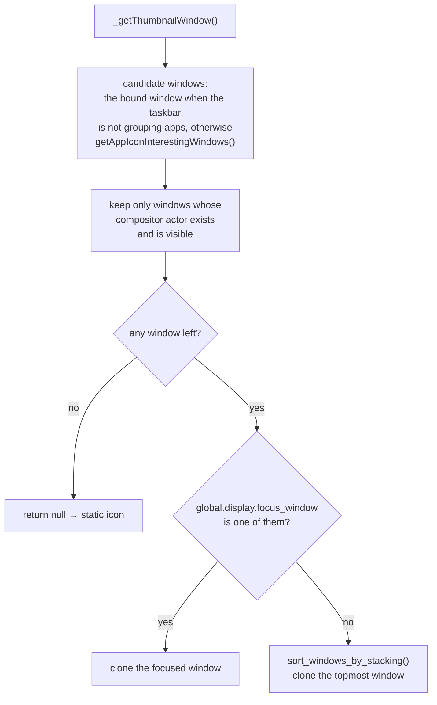
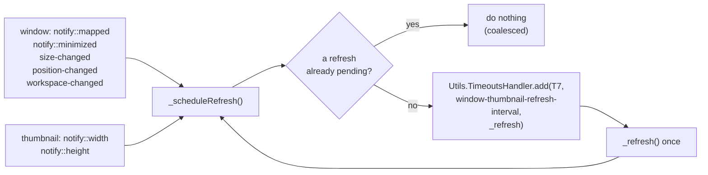
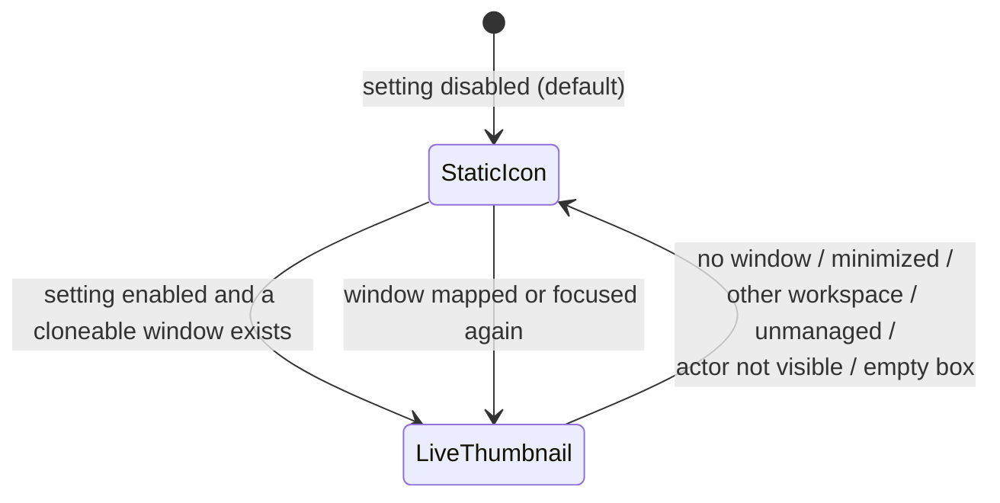
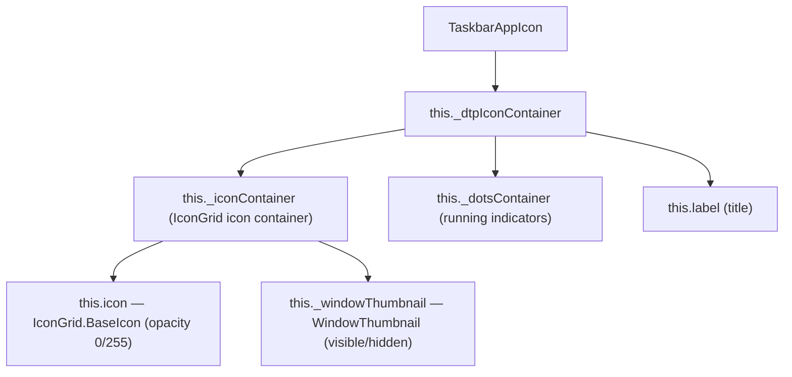

# Live window thumbnails instead of app icons

This document describes the new **"Show live window thumbnail instead of app icon"**
option added to Dash to Panel: instead of painting the static, themed application
icon in the taskbar, the panel button can show a **live thumbnail of one of the
application's windows**, the way GNOME 2 / MATE taskbars did.

The option is **disabled by default**. When it is off, the panel behaves exactly
as before and no clone actor is created.

---

## 1. What changed

| Area                | File                                                           | Change                                                                                                                                                                                                |
| ------------------- | -------------------------------------------------------------- | ----------------------------------------------------------------------------------------------------------------------------------------------------------------------------------------------------- |
| New settings        | `schemas/org.gnome.shell.extensions.dash-to-panel.gschema.xml` | Added `show-window-thumbnail-as-icon` (boolean, default `false`) and `window-thumbnail-refresh-interval` (integer, default `300` ms, range `100`–`2000`).                                             |
| Preferences UI      | `ui/SettingsBehavior.ui`                                       | Added an `AdwActionRow` + `GtkSwitch` ("Show live window thumbnail instead of app icon") to the _Behavior ▸ Hover_ group.                                                                             |
| Preferences binding | `src/prefs.js`                                                 | Bound `show-window-thumbnail-as-icon` to the new switch.                                                                                                                                              |
| Thumbnail actor     | `src/appIcons.js`                                              | New `WindowThumbnail` actor (a `Clutter.Clone` of the window's compositor texture) and the `TaskbarAppIcon` plumbing that decides when to show it.                                                    |
| Reused clone logic  | `src/windowPreview.js`                                         | Extracted the existing hover-preview clone code into the exported helpers `createWindowCloneBin()` and `fitWindowCloneInBox()`, and made `Preview` use them. The existing hover preview is unchanged. |
| Runtime toggling    | `src/taskbar.js`                                               | Reacts to `changed::show-window-thumbnail-as-icon` / `changed::window-thumbnail-refresh-interval` by updating the existing icons in place (no `resetAppIcons()`, so nothing flickers).                |
| Helper scripts      | `test-install.sh`, `cleanup-revert.sh`                         | Build/install a development copy and remove it again.                                                                                                                                                 |

---

## 2. How it works

### 2.1 High level flow



### 2.2 Choosing which window to clone



`windowActor.visible` is the same condition mutter uses to decide whether a window
is painted (`meta_window_should_be_showing()`), so a **minimized** window, a window
on an **inactive workspace**, or a window without a compositor actor yet is never
cloned — those cases fall back to the static icon automatically.

### 2.3 Throttled refresh



- `Clutter.Clone` tracks the source's texture, so the compositor keeps the pixels
  up to date by itself — the extension only has to re-run the _geometry_ work
  (size, scale, which actor is cloned) when something meaningful changes.
- All those changes are coalesced into **at most one refresh per interval**
  (`window-thumbnail-refresh-interval`, 300 ms by default, i.e. inside the
  requested 200–500 ms range). A burst of window resizes therefore costs one
  refresh, not hundreds.
- The clone is **reused** between refreshes: the `Clutter.Clone` actor is only
  re-created when the thumbnail switches to another window, and `source` is
  re-assigned only if the compositor actor actually changed.

### 2.4 Fallback



The static icon is **never removed**, only made transparent:

```js
this.icon.opacity = this._windowThumbnail.visible ? 0 : 255
```

Keeping it in the actor tree means it still determines the size of the icon
container, so enabling or disabling the feature (or losing the window) does not
make the panel button jump or reflow. Everything else about the button — the
running indicator dots, the label, the hover preview menu, click behaviour, drag
and drop, the notification "dance" animation — keeps working exactly as before.

### 2.5 Why the clone is _not_ returned from `createIcon()`

`IconGrid.BaseIcon` destroys and re-creates whatever `createIcon()` returns
whenever the icon theme or the icon size changes (`_createIconTexture()`,
`vfunc_style_changed()`, `_onIconThemeChanged()`), and the
`animate-appicon-hover` option even replaces `createIcon()` with a
`app.create_icon_texture(2 * iconSize)` closure at runtime. A `Clutter.Clone`
returned from there would be thrown away and would break the hover animation.
The thumbnail is therefore a **sibling** of the static icon inside
`_iconContainer`:



---

## 3. ASCII wireframes

### 3.1 Horizontal panel — before (default behaviour)

```
┌──────────────────────────────────────────────────────────────────────────────────┐
│  Activities   ┌───────┐  ┌───────┐  ┌───────┐  ┌───────┐          🔉  🔋  09:41 │
│               │  🔥   │  │  📁   │  │  >_   │  │  ✉    │                        │
│               └───────┘  └───────┘  └───────┘  └───────┘                         │
│                 ▲   ▲      ▲   ▲      ▲         ▲                               │
│                 │   │      │   │      │         │                               │
│              focused  unfocused indicator dots                                   │
│                                                                                  │
│               static, themed application icons (never change while running)      │
└──────────────────────────────────────────────────────────────────────────────────┘
```

### 3.2 Horizontal panel — after (setting enabled, applications running)

```
┌──────────────────────────────────────────────────────────────────────────────────┐
│  Activities   ┌───────┐  ┌───────┐  ┌───────┐  ┌───────┐          🔉  🔋  09:41 │
│               │▄▄▄▄▄▄▄│  │▀▀▀▀▀▀▀│  │  >_   │  │▄▄ ▄▄▄ │                        │
│               │█ live █│  │█ live █│  │       │  │█ live █│                        │
│               │▀▀▀▀▀▀▀│  │▄▄▄▄▄▄▄│  │       │  │▀▀ ▀▀▀ │                        │
│               └───────┘  └───────┘  └───────┘  └───────┘                         │
│                 ▲   ▲      ▲   ▲      ▲         ▲                               │
│                 │   │      │   │      │         │                               │
│              running applications show a live clone of their                     │
│              focused (or topmost) window, scaled to fit the icon box;            │
│              Firefox (not running) still shows its static icon                   │
└──────────────────────────────────────────────────────────────────────────────────┘
```

### 3.3 Zoom on a single button

```
   BEFORE (static icon)              AFTER (live thumbnail, running)
   ┌───────────────────┐             ┌───────────────────┐
   │      ┌─────┐      │             │ ┌───────────────┐ │
   │      │     │      │             │ │╭─────────────╮│ │  ← Clutter.Clone of
   │      │  🔥 │      │             │ ││  window     ││ │    window.get_compositor_
   │      │     │      │             │ ││  content    ││ │    private(), letterboxed
   │      └─────┘      │             │ │╰─────────────╯│ │    to keep the aspect ratio
   │        ● ●        │             │ └───────────────┘ │    (never upscaled)
   └───────────────────┘             │        ● ●        │
    icon = St.Icon (BaseIcon)        └───────────────────┘
                                      icon.opacity = 0, thumbnail visible
```

### 3.4 No cloneable window (minimized / other workspace / app closed)

```
┌───────────────────────────────────────────────────────────────────┐
│  ┌───────┐   ┌───────┐   ┌───────┐   ┌───────┐                    │
│  │  🔥   │   │  📁   │   │  >_   │   │  ✉    │                    │
│  └───────┘   └───────┘   └───────┘   └───────┘                    │
│                                                                   │
│   Minimized window, window on another workspace, application      │
│   closed or window not yet mapped  →  static icon is shown again  │
│   (the thumbnail simply hides itself).                            │
└───────────────────────────────────────────────────────────────────┘
```

### 3.5 Vertical panel

The thumbnail is layout agnostic: it fills the same box the icon would fill.

```
      BEFORE                AFTER
   ┌──────────┐          ┌──────────┐
   │  ┌────┐  │          │ ┌──────┐ │
   │  │ 🔥 │  │          │ │ live │ │
   │  └────┘  │          │ └──────┘ │
   │   ● ●    │          │   ● ●    │
   ├──────────┤          ├──────────┤
   │  ┌────┐  │          │ ┌──────┐ │
   │  │ 📁 │  │          │ │ live │ │
   │  └────┘  │          │ └──────┘ │
   │   ●      │          │   ●      │
   └──────────┘          └──────────┘
```

---

## 4. Settings

| Key                                 | Type | Default | Range        | Description                                                                                               |
| ----------------------------------- | ---- | ------- | ------------ | --------------------------------------------------------------------------------------------------------- |
| `show-window-thumbnail-as-icon`     | `b`  | `false` | –            | Show a live thumbnail of the focused or most recently used window of the application instead of its icon. |
| `window-thumbnail-refresh-interval` | `i`  | `300`   | `100`–`2000` | Milliseconds between two thumbnail refreshes. Higher values are lighter, lower values are more reactive.  |

Both can be set from a terminal for quick testing:

```sh
gsettings set org.gnome.shell.extensions.dash-to-panel show-window-thumbnail-as-icon true
gsettings set org.gnome.shell.extensions.dash-to-panel window-thumbnail-refresh-interval 300
```

---

## 5. Performance notes

- **Off by default.** With the setting disabled, no clone actor is ever created;
  the code path is a single boolean read.
- **At most one clone per application button**, and only for applications that
  actually have a visible window.
- **No per-frame work.** The compositor updates the cloned texture; the extension
  only re-runs the (cheap) geometry code on window/thumbnail signals.
- **Coalesced updates.** Any number of window changes within one interval results
  in exactly one `_refresh()`.
- **Clones are reused.** Switching windows re-creates the clone, but a plain
  resize/refresh only updates sizes and the `source` actor reference.
- **Never upscaled.** The clone is scaled down to fit the icon box
  (`Math.min(boxW / w, boxH / h, 1)`), so a small window is not blown up into a
  blurry thumbnail.

---

## 6. Testing

```sh
./test-install.sh      # make && make install-local, then follow the printed steps
./cleanup-revert.sh    # remove the development build and reset the GSettings
```

`test-install.sh` builds the extension, installs it into
`~/.local/share/gnome-shell/extensions/dash-to-panel@jderose9.github.com/`, and
prints the instructions to restart GNOME Shell (`Alt+F2`, `r`, `Enter` on X11, or
log out and back in on Wayland) and to enable the extension.
`cleanup-revert.sh` removes that directory, runs
`dconf reset -f /org/gnome/shell/extensions/dash-to-panel/`, and points back to the
official sources.

Things worth checking manually:

1. Enable the option and confirm running applications show a live thumbnail.
2. Focus another window of the same application — the thumbnail follows the focus.
3. Minimize the window / switch workspace — the static icon comes back.
4. Close the last window — the static icon comes back and the dots disappear.
5. Resize a window while watching the thumbnail — it stays inside the icon box
   and keeps its aspect ratio, without visible stutter.
6. Disable the option — every button immediately returns to the static icon
   (no shell restart, no panel flicker).
7. Hover a button — the existing window preview menu still works, unchanged.

---

## 7. Pull request description

> ### Show a live window thumbnail instead of the app icon in the panel
>
> Dash to Panel currently paints a static, themed icon for every running
> application. GNOME 2 and MATE instead showed a live preview of the window in
> the taskbar button, which makes it possible to tell at a glance _which_ window
> of an application is in front and what it contains.
>
> This PR adds that as an **opt-in** feature, controlled by a new GSettings key
> `show-window-thumbnail-as-icon` (**default `false`**), exposed as
> _Behavior ▸ Hover ▸ "Show live window thumbnail instead of app icon"_ in the
> preferences dialog. Users who do not enable it see no change at all.
>
> **How it works**
>
> - A new `WindowThumbnail` actor holds a `Clutter.Clone` of
>   `window.get_compositor_private()` — the same cloning approach the existing
>   hover preview already uses. The clone logic of `windowPreview.js` was
>   extracted into the reusable helpers `createWindowCloneBin()` and
>   `fitWindowCloneInBox()`; `Preview` now calls them, so there is no duplicated
>   implementation and the hover preview behaves exactly as before.
> - For each application button the extension picks the focused window of that
>   application, or the topmost one, and clones it. Windows that mutter is not
>   painting (minimized, on an inactive workspace, no compositor actor yet) are
>   skipped.
> - When there is no cloneable window, the thumbnail hides itself and the normal
>   application icon is shown again. The static icon is never removed, only
>   faded out (`icon.opacity`), so the panel button keeps its size and layout and
>   the running indicators, labels, tooltips, click behaviour, drag & drop and
>   notification animations are untouched.
> - Refreshes are **throttled**: all window signals (`notify::mapped`,
>   `notify::minimized`, `size-changed`, `position-changed`,
>   `workspace-changed`) are coalesced into at most one refresh per
>   `window-thumbnail-refresh-interval` (default **300 ms**, configurable
>   100–2000 ms), because cloning a window on every frame for every panel icon
>   would be expensive. Clones are reused between refreshes and scaled down to
>   fit the icon box, preserving the aspect ratio.
> - The setting is applied at runtime: `taskbar.js` updates the existing icons in
>   place instead of resetting all app icons, so toggling it never flickers the
>   panel.
>
> **Why the clone is not returned from `createIcon()`:** `IconGrid.BaseIcon`
> destroys and re-creates whatever `createIcon()` returns on icon theme/size
> changes, and the `animate-appicon-hover` option swaps `createIcon()` at
> runtime. The thumbnail is therefore added as a sibling of the static icon
> inside `_iconContainer`.
>
> **Testing:** `./test-install.sh` builds and installs the development copy,
> `./cleanup-revert.sh` removes it and resets the GSettings. Verified that the
> extension still builds with `make`, and that the new keys are compiled with the
> expected defaults. Not yet exercised in a live GNOME Shell session in this
> environment — see the checklist in `FEATURE.md`.
